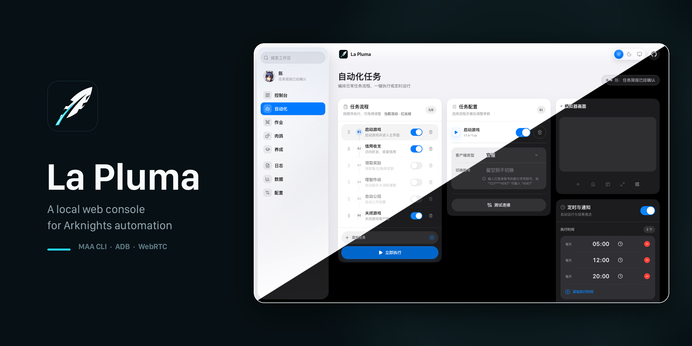
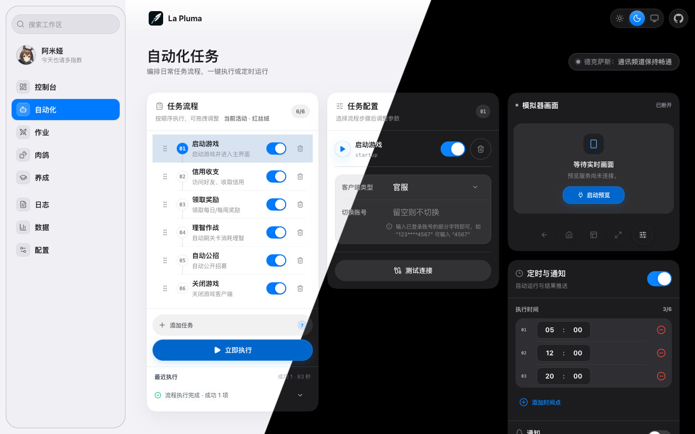
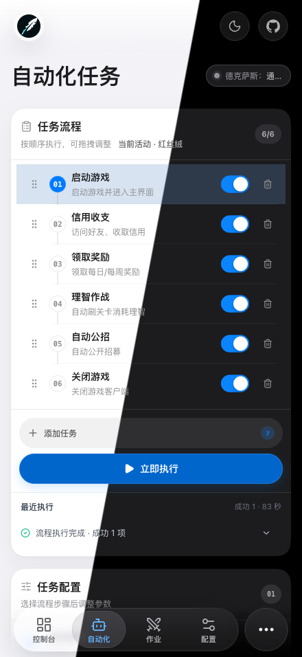

<p align="center">
  
</p>

<h1 align="center">La Pluma</h1>

<p align="center">《明日方舟》本地自动化控制台。</p>

<p align="center"><a href="README.md">English</a></p>

<p align="center">
  <a href="https://hub.docker.com/r/miaona/la-pluma"></a>
  <a href="https://hub.docker.com/r/miaona/la-pluma"></a>
  <a href="https://github.com/mps233/La-pluma/actions/workflows/docker-publish.yml"></a>
  <a href="https://go.dev/"></a>
  <a href="https://react.dev/"></a>
  <a href="https://github.com/MaaAssistantArknights/maa-cli"></a>
  <a href="https://awesomemygo.dev/apps/la-pluma"></a>
</p>

## 简介

La Pluma 是一个自托管的《明日方舟》自动化 Web 控制台。它把 `maa` CLI、ADB 与 Pion WebRTC 实时预览收进同一个界面：编排日常任务流、执行作业与肉鸽、设置定时运行，并在浏览器里查看模拟器画面。配置、运行记录、掉落数据和干员数据都留在运行服务的主机上。

除界面外，`/api/agent` 以语义化的 manifest 与 OpenAPI 暴露同一批能力，脚本和 AI Agent 可以查询动作、读取状态、预演计划并跟踪任务到终态。

项目名来自《明日方舟》五星近卫干员 La Pluma（羽毛笔）。

## 核心特性

### 控制台

- **今日总览** — 当前活动与剩余时间进度条；今日开放与未开放的资源本和芯片本；当前任务与最近结果；养成队列；今日掉落；ADB 设备健康度（CPU、内存、`/data` 磁盘、电池温度）。
- **一键日常** — 从控制台直接运行已保存的日常流程；「打当前活动」只准备匹配的作业，不会立即开战。
- **可选预览** — 关闭、每 10 秒刷新快照或打开 WebRTC 实时画面。快照失败时回退 ADB 截图；刷新失败时保留上一份成功数据。任务工作台的设备预览支持触摸控制。
- **响应式壳层** — 桌面侧栏支持工作区搜索；移动端底栏加「更多」弹层；亮色、暗色、跟随系统三档主题；iOS 风格材质。PWA 可在界面内安装和更新。
- **活动岛** — 导航栏中央的 Dynamic Island 式胶囊（[islandcn](https://islandcn.dev)）实时显示正在发生的事：自动化任务的环形进度与当前步骤、MAA 组件更新的已用时间，以及理智恢复情况。长按展开详情，任务或更新失败时会主动展开，手机上没有活动时自动让位给页面标题。

### 日常自动化

- **可编排流程** — 启动游戏、理智作战、基建换班、自动公招、信用收支、领取奖励、关闭游戏。支持拖动或方向键排序、单项启停、从选择器再次添加同类任务、撤销删除，并自动保存。
- **理智作战计划** — 多关卡与逐关次数、置顶关卡、由养成队列生成的智能关卡、理智药与临期药、源石、连战 `-1` 到 `10`、掉落目标、掉落服务器和上报。
- **运行期判断** — 资源本按开放日跳过未开放关卡；理智耗尽后停止后续关卡；当前活动代号替换 `HD-N`；剿灭入口不可用时按跳过处理。选择临期药天数、掉落服务器或 7–10 倍连战时，任务会改为动态 MAA 任务，上述逐关检查不再参与。
- **任务参数** — 基建换班模式与设施、无人机设置；公招星级、标签与时长规则；信用商店优先购买与黑名单；七类奖励；关游戏前可选识别仓库。
- **定时运行** — 每条流程最多 6 个每日时间点，可逐项启停，重启后恢复。同一时间只运行一条流程。
- **执行反馈** — 步骤进度与已用时；按 `runId` 终止；逐任务成功、失败、跳过统计；可展开掉落、上报、错误与警告。普通任务失败后会继续执行后续任务；启动游戏在重试耗尽后失败会结束整条流程。

### 作业

- **单作业与作业集** — 单作业使用 `prts://<id>`，作业集使用 `prts://s<id>`。可按链接或关卡名搜索，执行前预览关卡、干员与推荐项。
- **作业集进度** — 逐关勾选，普通与突袭进度分别保存，自动跳过已完成关卡，也可重置进度。
- **模式与参数** — 普通、突袭或两者；预设编队作业仅适用于普通。可设置循环次数、编队 1–4、按信赖补位、理智药、忽略等级与技能要求、助战模式与指定助战干员。
- **执行反馈** — 逐关状态、进度、战斗 OCR 击杀数与已用时。作业集可连续执行，也可每关暂停；手动会话在刷新页面后仍可继续。
- **当前活动** — 自动发现最佳作业集或逐关候选，校验 MAA 导航资源，按本地干员 Box 过滤，并在控制台记录通关进度。缺 2 名及以上干员的计划会跳过，缺 1 名时需助战模式允许才可补位。
- **保全派驻与悖论模拟** — 保全派驻一次执行一个作业并支持循环次数；悖论模拟可按干员搜索，显示热度与推荐结果。

### 肉鸽与生息演算

- **六个集成战略主题** — 傀影、水月、萨米、萨卡兹、界园、黑流树海，也可手输自定义主题代号。
- **主题感知模式** — 刷分、刷源石锭、凹开局、月度小队、深入调查，以及萨米、萨卡兹、界园和黑流树海的专属模式。模式列表随主题变化。
- **开局与策略** — 主题专属分队与职业组；最多 3 位开局干员并逐位设置助战；难度、运行次数、停止条件、投资选项和主题专属设置。
- **生息演算** — 沙洲遗闻与重启锚点，支持 RA-1、RA-15、RA-4 及各自参数。
- **草稿与恢复** — 设置短暂防抖后保存；服务端不可用时保留本地草稿；运行中的任务会在页面重新打开后恢复，并每 2 秒轮询。

### 干员、仓库与掉落

- **干员 Box** — 运行 MAA OperBox 识别，保存已拥有与全干员数量、收集率、精英化、等级与潜能。可按拥有状态、星级、职业、精英化、潜能筛选；阿米娅的三种形态计为同一名已拥有干员。
- **仓库** — 运行仓库识别，查看库存总量与分类汇总，并按图标和数量浏览完整清单。
- **养成计划** — 维护养成队列，查看当前目标材料缺口，为当前目标或整个队列生成刷取计划。计划列出开放与未开放关卡、预计次数与理智，并可作为智能关卡加入日常流程。
- **掉落记录** — 3、7、14、30 天周期，统计总理智与平均理智、战斗次数、理智药、源石、主要材料与逐关明细。
- **材料数据** — 游戏数据变化时，可从公开的 ArknightsGameData 仓库刷新材料、配方与干员材料 JSON；养成计划另外读取 MaaResource 的物品数据。

### 小工具

- **五个工具** — 像素画填色、自动提升潜能、缺口材料合成、刷傀影皇冠、活动商店兑换。
- **像素画编辑器** — 24×24 点阵、0–39 色，支持拖动填色、逐格延迟和带确认的清空。
- **先检查再执行** — 参数检查只返回计划，不启动 MAA；真实执行会立即开始并改变游戏或账号状态。

### 通知与远程控制

- **Telegram 完成通知** — 默认关闭。开启渠道并保存 Bot Token 与 Chat ID 后，会收到逐任务结果、掉落、上报、警告、跳过与失败汇总。只有流程执行过领取奖励步骤时才附带截图；图片超过 10 MB 或发送失败时回退为文字。
- **Bot 命令** — `/status`、`/screenshot`、`/startup`、`/closedown`、`/fight`、`/roguelike`、`/copilot`、`/stop`、`/run`（运行已保存流程）；也可直接发送 `prts://` 链接，或使用中文关键词别名。只接受配置的 Chat ID 或用户 ID。
- **本地凭据** — Bot Token 与 Chat ID 保存在本地通知配置中。桌面版会生成并保存访问令牌（可在「配置 → 访问令牌」修改或复制）；设置 `LA_PLUMA_TOKEN` 可覆盖它。控制台若可被 localhost 以外访问，请避免暴露到不可信网络。

### Agent API

- **可发现接口** — `/api/agent/manifest` 与 `/api/agent/openapi.json` 由同一份注册表生成。Manifest 公开 26 个动作及其风险、dry-run、轮询与停止信息；OpenAPI 文档包含全部已注册操作。
- **语义化动作** — 状态、连接测试、设备发现、当前活动预检、启动游戏、理智作战、日常流程、截图、最近日志、WebRTC 预览和可运行五个白名单工具的小工具入口，另有白名单 `run-task` 通用入口。
- **可跟踪 Run** — 有副作用的动作返回 `runId`、`run`、`pollUrl` 与 `stopUrl`；后台执行返回 HTTP 202。Run 与幂等记录在外部副作用开始前持久化，重启后未完成的 Run 变为不可重试的 `interrupted`，终态最多保留 24 小时或 500 条。
- **安全执行** — `dryRun` 只返回计划，不启动 MAA；`Idempotency-Key` 会重放原 Run；另一条 La Pluma 执行持有 MAA 租约时返回 HTTP 409。

### 界面与部署

- **技术栈** — 前端 React 19、TypeScript、Vite、Tailwind CSS、Framer Motion、Zustand；后端 Go 1.27，使用 `net/http`、Pion WebRTC 与内嵌 TURN。
- **部署** — 单个 Go 二进制或多架构 Docker 镜像（`linux/amd64`、`linux/arm64`）、可选 HTTPS 与子路径托管。
- **PWA** — 可在 HTTPS 或 localhost 安装，离线时能打开界面壳层；自动化与设备控制始终需要后端。
- **语言** — 界面目前为中文。

## 界面截图

<p align="center">
  
  <br />
  <em>桌面端自动化工作台</em>
</p>

<p align="center">
  
  <br />
  <em>同一工作台在手机上的布局</em>
</p>

## 快速开始

### 环境要求

- **Go 1.27+** — 构建后端与 MyGo 桌面外壳。
- **Node.js 22.12+** — 仅用于 React 客户端的构建与测试；运行中的服务端不依赖 Node。
- **maa CLI 与 MaaCore** — 安装 CLI 后执行一次 `maa install`。macOS：`brew install MaaAssistantArknights/tap/maa-cli`。
- **ADB** — 系统安装或模拟器自带均可；请在 **配置 → 连接** 中指向实际路径，默认值是 macOS Homebrew 的位置。
- **运行环境** — macOS、Linux 或 Docker。

### 本地运行

```bash
git clone https://github.com/mps233/La-pluma.git
cd La-pluma
npm run install:all

# 终端 1：Go 后端，监听 http://localhost:3000
cd go && go run ./cmd/server

# 终端 2：Vite 客户端，监听 http://localhost:5173
cd .. && npm run dev:client
```

打开 http://localhost:5173。Vite 会把 `/api` 与 `/webrtc-signaling` 代理到 3000 端口的 Go 服务。

由 Go 后端提供正式构建时：

```bash
npm run build
cd go
LA_PLUMA_CLIENT_DIST=../client/dist go run ./cmd/server
```

### Docker 运行

```bash
docker pull miaona/la-pluma:latest

docker run -d \
  --name la-pluma \
  -p 3055:3000 \
  -v /path/to/data:/app/data \
  -v /path/to/maa-config:/root/.config/maa \
  -v /path/to/maa-data:/root/.local/share/maa \
  -e ADB_PATH=/usr/bin/adb \
  -e ADB_ADDRESS=192.168.1.10:5555 \
  miaona/la-pluma:latest
```

打开 http://localhost:3055。`ADB_ADDRESS` 必须是容器内可访问的宿主机或模拟器地址；默认 bridge 网络下，`127.0.0.1` 指向容器自身。镜像把 ADB 安装在 `/usr/bin/adb`，因此 Docker 中必须覆盖 `ADB_PATH`。

镜像首次启动时若缺少 MaaCore 会自动安装。Go 镜像由 `go/Dockerfile` 构建。仓库也提供 `docker-compose.yml`；运行 `docker compose up -d` 前请先修改其中的宿主机路径与 ADB 地址，并在 `environment` 中加入 `ADB_PATH=/usr/bin/adb`。

## 配置

连接设置在 **配置 → 连接**：ADB 路径与地址、客户端类型、触控模式、自动重连和连接预设。**查找模拟器** 会扫描 ADB 与常见本机端口。

关键环境变量：

| 变量 | 用途 | 默认值 |
| --- | --- | --- |
| `PORT` | HTTP 端口 | `3000` |
| `LA_PLUMA_HOST` | 监听地址（headless；桌面版也读取，默认 `127.0.0.1`，设为 `0.0.0.0` 可允许局域网访问） | `0.0.0.0` headless / `127.0.0.1` 桌面版 |
| `LA_PLUMA_DATA_DIR` | 配置、Run 存储与 MAA 任务文件 | `<工作目录>/server/data` |
| `LA_PLUMA_CLIENT_DIST` | 构建后的 React 客户端 | `<工作目录>/client/dist` |
| `LA_PLUMA_TOKEN` | 要求 `/api` 与 WebRTC 票据接口携带令牌（headless；覆盖桌面端令牌） | 空：headless 关闭鉴权，桌面版使用已保存的令牌 |
| `LA_PLUMA_BASE_PATH` | 运行时挂载路径；需与构建时 `VITE_BASE_PATH` 一致 | `/` |
| `LA_PLUMA_HTTPS_CERT_PATH` | 证书链；与私钥同时设置 | 空，HTTP |
| `LA_PLUMA_HTTPS_KEY_PATH` | 私钥；与证书链同时设置 | 空，HTTP |
| `ADB_PATH` | ADB 可执行文件 | 平台默认（macOS 为 `/opt/homebrew/bin/adb`，其它为 `adb`） |
| `ADB_ADDRESS` | 默认 ADB 设备地址 | `127.0.0.1:16384` |
| `MAA_CLI_PATH` | `maa` 可执行文件 | `maa`；Docker 使用 `/usr/local/bin/maa` |
| `MAA_CONFIG_DIR` | MAA profiles 与任务文件 | 平台 MAA 配置目录 |
| `LA_PLUMA_WEBRTC_TURN_PORT` | 内嵌 TURN/STUN UDP 端口 | `3478` |
| `LA_PLUMA_WEBRTC_TURN_PUBLIC_IP` | 向浏览器通告的中继地址 | 自动检测局域网 IPv4 |
| `LA_PLUMA_WEBRTC_TURN_USERNAME` / `..._PASSWORD` | TURN 凭据 | `la-pluma` / 自动生成 |
| `LA_PLUMA_WEBRTC_TURN_DISABLED` | 关闭内嵌 TURN | 未设置 |

<details>
<summary>HTTPS、子路径与 WebRTC 说明</summary>

**HTTPS。** 同时设置 `LA_PLUMA_HTTPS_CERT_PATH` 与 `LA_PLUMA_HTTPS_KEY_PATH` 才会以 HTTPS 启动；只设置一项会中止启动。PWA 安装与离线缓存需要 HTTPS 或 `localhost`。若由反向代理终止 TLS，请转发 `/api`、`/health` 与 `/webrtc-signaling`，并为最后一项允许 WebSocket Upgrade。

**子路径。** 构建时设置 `VITE_BASE_PATH=/la-pluma/`，运行时设置 `LA_PLUMA_BASE_PATH=/la-pluma/`。Docker 可通过构建参数 `VITE_BASE_PATH` 传入。`/api`、`/health` 与信令网关仍位于源站根路径。

**WebRTC。** 浏览器预览统一走同源 `/webrtc-signaling` 网关，上游管理凭据只保存在后端。信令票据一次性使用，15 秒后过期。组件安装与升级会从 GitHub Release 下载、校验 SHA256、保留 `data/` 与 `certs/`，并备份旧目录；安装前需要先停止服务。低于 `v0.4.3` 的设备端 Agent 会显示为过旧。

</details>

## 使用方式

1. 在「配置」中设置模拟器连接。
2. 在「自动化」中编排流程，立即执行或添加每日时间。
3. 在「作业」执行作业，在「肉鸽」执行集成战略或生息演算。
4. 在「日志」查看进度，或让「控制台」保持打开以查看状态、掉落和可选预览。

### Agent API

```bash
# 查询动作清单与紧凑状态
curl http://localhost:3000/api/agent/manifest
curl http://localhost:3000/api/agent/status

# 预演理智作战，不启动 MAA
curl -X POST http://localhost:3000/api/agent/actions/fight \
  -H 'Content-Type: application/json' \
  -d '{"stages":[{"stage":"1-7","times":3}],"dryRun":true}'

# 幂等运行已保存的日常流程
curl -X POST http://localhost:3000/api/agent/actions/run-daily-flow \
  -H 'Content-Type: application/json' \
  -H 'Idempotency-Key: daily-flow-20261104-01' \
  -d '{}'

# 轮询当前 Run，必要时终止指定 Run
curl 'http://localhost:3000/api/agent/runs/current?lines=80'
curl -X POST http://localhost:3000/api/agent/runs/<runId>/stop
```

设置 `LA_PLUMA_TOKEN` 后，请发送 `Authorization: Bearer <token>` 或 `X-La-Pluma-Token`。`/health` 与只读的 `/api/maa-assets` 图片路由保持公开，以便界面加载物品和干员头像。

## 项目结构

```text
La-pluma/
├─ client/                 React + TypeScript + Vite 前端
│  ├─ src/components/      控制台、自动化、作业、肉鸽、养成、数据、小工具
│  ├─ src/components/islandcn/  活动岛内容组件（islandcn）
│  ├─ src/lib/island/      活动岛引擎（islandcn）
│  ├─ src/hooks/           后端、Run、预览、理智与更新状态监控
│  ├─ src/services/api.ts  /api/agent 客户端
│  ├─ src/store/           Zustand 状态
│  └─ public/              PWA 图标与 Logo
├─ go/                     Go 后端与 MyGo 桌面外壳
│  ├─ cmd/server/          headless HTTP 服务
│  ├─ cmd/desktop/         MyGo 桌面入口
│  ├─ internal/app/        MAA、调度、Run、WebRTC、养成、通知
│  ├─ internal/infra/      ADB、MAA、scrcpy 与 WebRTC 适配
│  └─ internal/transport/  HTTP、Agent API 与信令
├─ screenshots/            README 图片
├─ docs/                   MAA 集成说明
├─ go/Dockerfile
├─ docker-compose.yml
└─ package.json            仅客户端构建/测试脚本
```

## 文档

| 文档 | 内容 |
| --- | --- |
| `README.md` | 英文概览、安装部署与 Agent API |
| `README.zh.md` | 本文件 |
| `AGENTS.md` | 仓库规则与编码 Agent 的验证命令 |
| `DESIGN.md` | 视觉与组件规范 |
| `client/src/components/common/README.md` | 通用组件 props 与示例 |
| `go/README.md` | Go 后端安装、状态与已知缺口 |
| `docs/maa.md` | MAA CLI/Core 集成现状、边界与已知缺口 |

## 许可证

MIT 许可证。

## 致谢

- [MAA (MaaAssistantArknights)](https://github.com/MaaAssistantArknights/MaaAssistantArknights) — 自动化引擎。
- [maa-cli](https://github.com/MaaAssistantArknights/maa-cli) — La Pluma 驱动的命令行接口。
- [Pion WebRTC](https://github.com/pion/webrtc) — 浏览器预览传输；设备画面由 scrcpy 提供。
- [PenguinStats](https://penguin-stats.io/) 与 [PRTS](https://prts.maa.plus/) — 掉落数据与作业。
